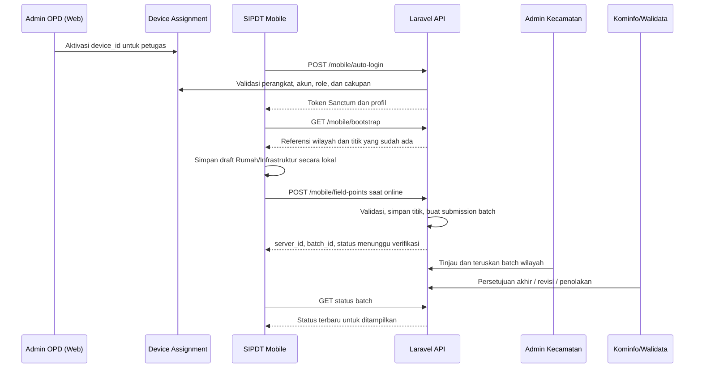
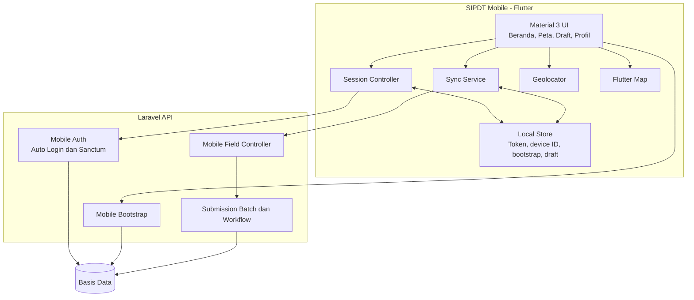
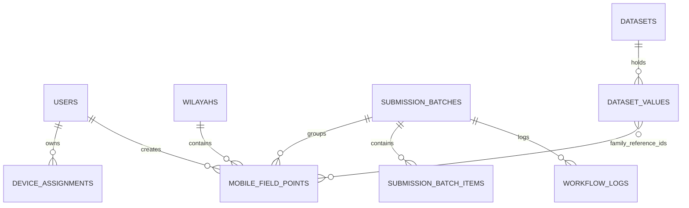
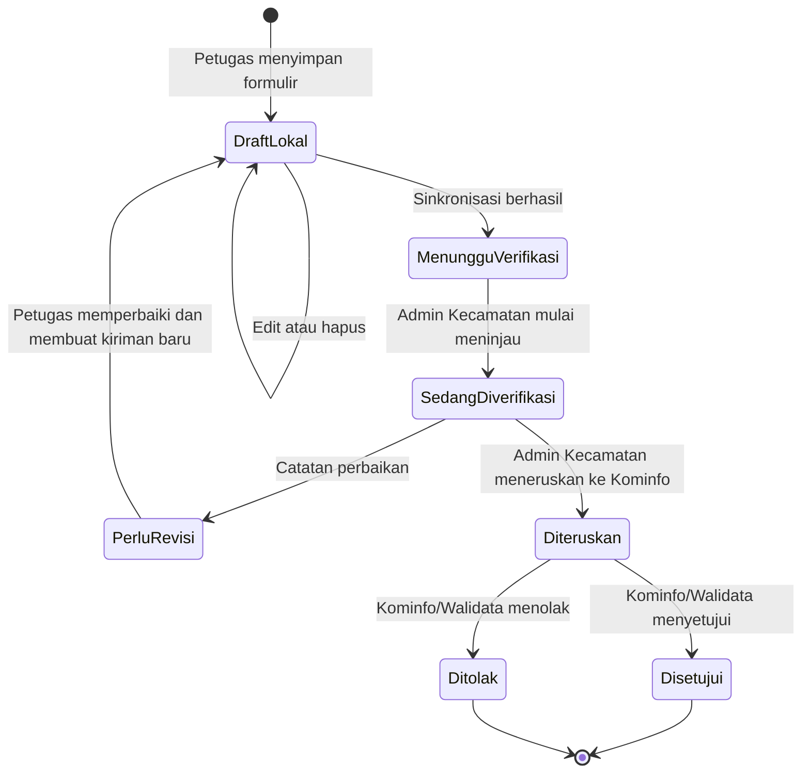

# ANALISIS DAN PERANCANGAN SISTEM MOBILE
## SIPDT Mobile — Pendataan Lapangan Terintegrasi Kabupaten Kepulauan Sangihe

**Jenis dokumen:** Analisis dan Perancangan Aplikasi Mobile  
**Basis audit:** Source code proyek pada 2 November 2026  
**Ruang lingkup:** Aplikasi Flutter, API mobile, penyimpanan lokal, sinkronisasi, dan workflow pendataan lapangan  
**Status:** Dokumen kondisi implementasi saat ini dan rancangan pengembangan

---

## Ringkasan Eksekutif

SIPDT Mobile adalah aplikasi pendataan lapangan untuk petugas berperan `admin_lapangan` atau `admin_desa`. Aplikasi berfokus pada pencatatan titik spasial rumah dan infrastruktur pada wilayah tugas, termasuk koordinat GPS, alamat, atribut, serta keterhubungan dengan data keluarga yang sudah diterbitkan oleh OPD. Aplikasi menerapkan pola **offline-first**: data dapat dibuat sebagai draft lokal ketika jaringan tidak tersedia, kemudian dikirim ke server saat koneksi kembali tersedia.

Hasil audit memperlihatkan aplikasi dikembangkan dengan Flutter dan Material 3. Backend menggunakan API Laravel yang dilindungi Laravel Sanctum. Aktivasi akses mobile dilakukan melalui pengaitan perangkat oleh administrator pada panel web. Setelah perangkat aktif, aplikasi melakukan auto-login memakai identitas perangkat, mengambil bootstrap wilayah/referensi, menyimpan draft secara lokal, mengirim operasi dengan UUID agar idempoten, dan menampilkan perkembangan status batch verifikasi.

Ruang lingkup sinkronisasi yang aktif saat audit adalah **Rumah** dan **Infrastruktur**. Halaman/form Keluarga serta Penduduk masih ditemukan pada proyek, tetapi layanan sinkronisasi sengaja menolak pengiriman jenis tersebut; data keluarga yang dapat dipilih di mobile berasal dari dataset OPD yang telah berstatus `published`.

---

# BAB III — ANALISIS SISTEM

## 3.1 Metode dan Batas Audit

Audit dilakukan secara statis terhadap `mobile/pubspec.yaml`, kode Flutter pada `mobile/lib`, test pada `mobile/test`, route dan controller API mobile, model/migration pendukung, serta service workflow Laravel. Audit tidak termasuk pengujian pada perangkat fisik, verifikasi kualitas GPS di lapangan, pemeriksaan keamanan perangkat yang telah di-root, atau uji beban server.

| Area | Artefak yang diperiksa | Kesimpulan utama |
|---|---|---|
| Aplikasi | `main.dart`, `app.dart`, halaman fitur, model | Flutter dengan Material 3; menu utama Beranda, Peta, Pengiriman Draft, dan Profil. |
| Sesi | `SessionController`, `ApiClient`, `DeviceAssignment` | Auto-login berbasis `device_id` untuk perangkat yang diaktifkan dan role petugas lapangan/desa. |
| Penyimpanan lokal | `LocalStore`, `shared_preferences`, UUID | Token, ID perangkat, bootstrap, cursor, dan draft disimpan secara lokal; penulisan draft diserialkan untuk mencegah saling timpa. |
| Sinkronisasi | `SyncService`, endpoint `field-points` | Draft Rumah/Infrastruktur dikirim sebagai operasi ber-UUID; hasil dan status batch disimpan kembali ke perangkat. |
| Backend | `MobileBootstrapController`, `MobileFieldController` | Server membatasi desa sesuai penugasan, memvalidasi koordinat dan keluarga referensi, lalu membuat batch workflow. |
| Peta | `flutter_map`, `geolocator` | Peta menampilkan rumah, infrastruktur, dan lokasi petugas bila izin lokasi tersedia. |

## 3.2 Permasalahan yang Diselesaikan

Pendataan objek di wilayah kepulauan atau area dengan konektivitas terbatas menghadapi kendala berikut.

1. Petugas tidak selalu memiliki koneksi internet stabil saat berada di lapangan.
2. Koordinat dan kondisi objek perlu dicatat langsung di lokasi, bukan dikumpulkan kembali secara manual.
3. Data lapangan harus dibatasi pada desa/kecamatan penugasan petugas.
4. Data yang masuk dari lapangan belum boleh langsung dianggap sebagai data resmi.
5. Petugas membutuhkan informasi jelas tentang draft yang belum terkirim, telah masuk server, atau sudah diverifikasi.
6. Data keluarga tidak boleh diketik ulang sembarangan; rujukan keluarga perlu berasal dari data OPD yang sudah diterbitkan.

## 3.3 Analisis Sistem Berjalan

### 3.3.1 Alur Operasional



### 3.3.2 Aktor dan Hak Akses

| Aktor | Tanggung jawab | Batas akses |
|---|---|---|
| Admin OPD | Mengaktifkan perangkat petugas melalui panel web. | Mengelola perangkat/akun sesuai otoritas panel. |
| Admin Lapangan | Mengambil koordinat dan mencatat rumah/infrastruktur. | Hanya desa atau kecamatan yang ditugaskan pada akun. |
| Admin Desa | Menggunakan fungsi mobile pada desa yang ditugaskan. | Hanya desa atau kecamatan yang ditugaskan pada akun. |
| Admin Kecamatan | Meninjau pendataan lapangan. | Batch pendataan lapangan di kecamatan wilayah kerja. |
| Kominfo/Walidata | Memverifikasi akhir dan menerbitkan hasil yang telah diteruskan. | Akses kabupaten sesuai role verifikator. |

### 3.3.3 Fitur yang Terimplementasi

| Kode | Fitur | Implementasi saat audit |
|---|---|---|
| MF-01 | Auto-login perangkat | Aplikasi mengirim UUID perangkat ke `/mobile/auto-login`; server memeriksa `device_assignments`, status akun, role, dan wilayah. |
| MF-02 | Penanganan kondisi sesi | Aplikasi membedakan perangkat belum aktif, gangguan server, dan tidak ada koneksi. |
| MF-03 | Mode offline | Petugas dapat membuka UI dan menyimpan draft lokal saat koneksi tidak tersedia. |
| MF-04 | Bootstrap data | Aplikasi mengambil profil, daftar desa/dusun, dataset aktif, titik rumah, dan infrastruktur sesuai cakupan petugas. |
| MF-05 | Pendataan rumah | Form memuat pilihan desa, alamat, titik GPS, status rumah, dan pemilihan keluarga referensi. |
| MF-06 | Pendataan infrastruktur | Form mendukung jenis jalan, jembatan, drainase, lampu jalan, air bersih, dan lainnya beserta titik GPS. |
| MF-07 | Peta lapangan | Menampilkan titik rumah, infrastruktur, draft lokal, pencarian, legenda, dan lokasi petugas. |
| MF-08 | Draft lokal | Draft memiliki `local_id`, payload, status sinkronisasi, error, ID server, dan ID batch. |
| MF-09 | Sinkronisasi | Mengirim maksimal operasi yang tervalidasi ke endpoint `field-points`; mendukung kirim semua, kirim satu, dan coba ulang. |
| MF-10 | Status verifikasi | Aplikasi meminta status batch untuk mengetahui data masih menunggu, direvisi/ditolak, atau disetujui. |

### 3.3.4 Kebutuhan Fungsional

| Kode | Kebutuhan | Kriteria penerimaan |
|---|---|---|
| KM-01 | Sistem harus mengizinkan perangkat aktif masuk tanpa halaman password. | Perangkat valid menerima token dan profil petugas. |
| KM-02 | Sistem harus menolak perangkat yang tidak diaktifkan. | Aplikasi menampilkan halaman aktivasi dan arahan menghubungi admin. |
| KM-03 | Sistem harus membatasi data per desa/kecamatan petugas. | Bootstrap, pencarian keluarga, baca titik, dan unggah ditolak bila di luar cakupan. |
| KM-04 | Petugas harus dapat mencatat rumah dengan koordinat valid. | Latitude berada pada -90 s.d. 90; longitude -180 s.d. 180. |
| KM-05 | Petugas harus dapat mencatat infrastruktur dengan jenis yang diizinkan. | Jenis tervalidasi server: rumah, jalan, jembatan, drainase, lampu_jalan, air_bersih, lainnya. |
| KM-06 | Data harus dapat disimpan ketika offline. | Draft muncul pada halaman pengiriman setelah aplikasi dibuka kembali. |
| KM-07 | Sinkronisasi tidak boleh menggandakan operasi yang sama. | UUID `operation_id` yang sama menghasilkan respons atas data server yang sudah ada. |
| KM-08 | Hanya keluarga dari sumber dataset terbit yang dapat dikaitkan. | Server memvalidasi status `published`, desa, dan dataset sumber. |
| KM-09 | Data kiriman harus masuk workflow verifikasi. | Server membuat `SubmissionBatch`, item batch, snapshot, dan status menunggu verifikasi. |
| KM-10 | Petugas harus dapat melihat hasil proses batch. | Status batch diperbarui pada draft yang telah dikirim. |

### 3.3.5 Kebutuhan Nonfungsional

| Aspek | Kebutuhan dan rancangan |
|---|---|
| Offline-first | Pengambilan bootstrap dicache; draft dapat dibuat tanpa koneksi; sinkronisasi dilakukan atas tindakan pengguna. |
| Keamanan | Token API, pengaitan perangkat, validasi role, validasi wilayah server-side, serta pembatasan endpoint Sanctum. |
| Integritas | UUID operasi unik, transaction server saat membuat titik dan batch, validasi keluarga, serta status workflow. |
| Usability | Bahasa Indonesia, indikator status, peta, tombol GPS, halaman koneksi/aktivasi yang jelas, dan Material 3. |
| Performa | Bootstrap dan daftar titik dibatasi sesuai cakupan; endpoint titik membatasi hasil; operasi unggah maksimal 100 per permintaan. |
| Ketersediaan | Aplikasi tetap menyediakan draft lokal; server perlu HTTPS, pemantauan, backup, dan rencana pemulihan. |
| Kompatibilitas | Flutter SDK `>=3.2.0 <4.0.0`; target platform terutama Android, dengan dependency geolokasi dan peta. |

## 3.4 Aturan Bisnis Mobile

1. Hanya `admin_lapangan` dan `admin_desa` yang dapat menggunakan endpoint mobile lapangan.
2. Akun petugas harus mempunyai `desa_id` atau `kecamatan_id` dan status aktif.
3. `device_id` harus terdaftar serta aktif pada `device_assignments` untuk auto-login.
4. Petugas dengan desa spesifik hanya melihat dan mengirim data desa tersebut; petugas kecamatan dapat ditugaskan pada desa di bawah kecamatan tersebut.
5. Setiap draft yang dikirim memiliki UUID `operation_id` sebagai kunci idempotensi.
6. Rumah atau infrastruktur yang diterima server tidak otomatis terbit. Server membuat batch modul `lapangan` dengan status menunggu verifikasi.
7. Batch lapangan diperiksa Admin Kecamatan, diteruskan ke Kominfo, lalu disetujui/ditolak/dikembalikan menurut workflow kabupaten.
8. Daftar keluarga di aplikasi bukan input keluarga lokal. Data tersebut hanya berasal dari dataset aktif dengan konfigurasi `mobile_family_source`, cakupan desa, status `published`, dan `published_at` terisi.

## 3.5 Hasil Audit dan Rekomendasi

### 3.5.1 Kekuatan Sistem

1. Hak akses dicek di server pada bootstrap, pembacaan titik, pengambilan keluarga, dan unggah; pembatasan tidak hanya mengandalkan UI mobile.
2. UUID operasi dan pemeriksaan operasi yang sudah ada mengurangi risiko duplikasi ketika pengguna menekan kirim ulang saat koneksi tidak stabil.
3. Pembuatan titik, batch, dan item batch dilakukan dalam transaksi basis data.
4. Aplikasi menyimpan cache bootstrap sehingga referensi wilayah dapat digunakan tanpa menunggu jaringan.
5. UI membedakan masalah aktivasi perangkat dari masalah koneksi sehingga petugas mendapat arahan yang lebih tepat.
6. Alur keluarga menghindari duplikasi master data dengan memakai data OPD yang telah diterbitkan.

### 3.5.2 Temuan yang Perlu Ditindaklanjuti

| Prioritas | Temuan | Dampak | Rekomendasi |
|---|---|---|---|
| Tinggi | `flutter_secure_storage` tersedia sebagai dependency, tetapi token pada implementasi `LocalStore` tersimpan di `SharedPreferences`. | Token dapat lebih mudah diekstrak pada perangkat yang dikompromikan. | Pindahkan token akses ke `flutter_secure_storage`; hapus token saat logout/perangkat dinonaktifkan. |
| Tinggi | Endpoint default menggunakan HTTP emulator (`http://10.0.2.2:8000`). | Tidak aman untuk produksi bila konfigurasi tidak diganti. | Wajib gunakan HTTPS pada domain produksi dan injeksikan `SIPDT_API_BASE_URL` saat build. |
| Sedang | Mode offline dapat membuat pengguna placeholder `Admin Desa (Demo)` bila belum terautentikasi. | Draft tanpa cakupan desa yang valid tidak dapat dikirim dan dapat membingungkan petugas. | Batasi pembuatan draft pada mode ini atau beri penanda kuat bahwa draft perlu memilih/menunggu cakupan resmi sebelum sinkron. |
| Sedang | Penyimpanan draft menggunakan `SharedPreferences`. | Kurang ideal untuk banyak data, berkas foto, antrian besar, atau query kompleks. | Untuk pengembangan berikutnya, gunakan SQLite/Drift/Isar dan mekanisme migrasi data lokal. |
| Sedang | Form Keluarga dan Penduduk ada di source, tetapi sinkronisasi hanya menerima Rumah/Infrastruktur. | Ruang lingkup tampak lebih luas daripada layanan yang benar-benar aktif. | Sembunyikan fitur nonaktif dari navigasi atau selesaikan kontrak backend sebelum diaktifkan. |
| Sedang | Auto-login hanya berlandaskan ID perangkat yang tersimpan lokal. | Perangkat hilang perlu segera dinonaktifkan dari web. | Sediakan revokasi perangkat, masa berlaku token, audit perangkat, dan notifikasi perangkat baru. |
| Rendah | Belum ada bukti enkripsi database draft, geofence, atau bukti foto. | Fitur belum memadai untuk skenario data sensitif/validasi fisik tingkat tinggi. | Tambahkan bila menjadi kebutuhan: enkripsi lokal, accuracy GPS, timestamp, foto, dan validasi geofence. |

---

# BAB III — PERANCANGAN SISTEM MOBILE

## 3.6 Arsitektur Aplikasi



### 3.6.1 Komponen Flutter

| Komponen | Tanggung jawab |
|---|---|
| `main.dart` | Inisialisasi binding Flutter, `LocalStore`, `ApiClient`, dan `SessionController`. |
| `app.dart` | Tema Material 3 serta pemilihan halaman awal berdasarkan sesi, aktivasi, koneksi, dan mode offline. |
| `SessionController` | Memulihkan token, auto-login perangkat, logout, klasifikasi error, dan mode offline. |
| `ApiClient` | Membentuk request HTTP, menyertakan token, membaca respons API, dan memetakan error. |
| `LocalStore` | Menyimpan ID perangkat, token, bootstrap, cursor, serta daftar draft secara serial. |
| `SyncService` | Mengelompokkan/mengirim draft, menyimpan respons, melakukan retry, dan menyegarkan status batch. |
| `HomePage` | Menampilkan tab Beranda, Peta, Pengiriman Draft, dan Profil. |
| `RumahCapturePage` | Mengisi detail rumah, koordinat GPS, dan relasi keluarga. |
| `InfrastrukturCapturePage` | Mengisi detail jenis infrastruktur, lokasi, dan atribut. |
| `MapPage` | Menampilkan titik server/draft lokal serta fasilitas pencarian dan lokasi pengguna. |
| `SyncPage` | Menampilkan jumlah draft, status pengiriman, aksi kirim ulang, dan hapus draft lokal. |

## 3.7 Perancangan Data

### 3.7.1 Model Data Lokal

| Data lokal | Isi | Kegunaan |
|---|---|---|
| Token | Token Sanctum hasil login perangkat | Otorisasi request API setelah auto-login. |
| Device ID | UUID yang dibuat satu kali pada perangkat | Identitas perangkat untuk aktivasi. |
| Bootstrap | Profil, referensi wilayah, daftar titik, dan dataset | Memberikan data awal saat offline. |
| Draft | `local_id`, tipe, payload, waktu, state sinkron, server ID, batch ID, error | Menyimpan pekerjaan petugas sampai tersinkron. |
| Pull cursor | Posisi sinkronisasi/pull bila digunakan pengembangan berikutnya | Mendukung pemrosesan pembaruan bertahap. |

### 3.7.2 Model Data Server



| Entitas | Atribut utama | Fungsi |
|---|---|---|
| `device_assignments` | `user_id`, `device_id`, label, platform, aktif, waktu aktivasi/terlihat | Menghubungkan perangkat dengan akun petugas. |
| `mobile_field_points` | UUID operasi, desa, jenis, nama, alamat, latitude, longitude, atribut, keluarga referensi, batch | Menyimpan titik Rumah/Infrastruktur hasil mobile. |
| `submission_batches` | modul, kecamatan, status, snapshot payload, pembuat, waktu | Header workflow data lapangan. |
| `submission_batch_items` | batch, tipe entitas, ID entitas | Menghubungkan titik dengan batch. |
| `workflow_logs` | batch, perubahan status, aktor, catatan | Menyediakan jejak perubahan workflow. |
| `dataset_values` | dataset, wilayah, nilai JSON, status publikasi | Menjadi sumber keluarga yang boleh dipilih mobile. |

## 3.8 Perancangan Navigasi dan Antarmuka

### 3.8.1 Struktur Navigasi

```text
SIPDT Mobile
|
+-- Beranda Desa
|   +-- ringkasan rumah dan keluarga terhubung
|   +-- tambah pendataan rumah
|   +-- tambah pendataan infrastruktur
|
+-- Peta Spasial Rumah
|   +-- titik rumah
|   +-- titik infrastruktur
|   +-- lokasi saya dan pencarian
|
+-- Pengiriman Draft
|   +-- antrean draft
|   +-- kirim semua / kirim satu / coba ulang
|   +-- status batch verifikasi
|
+-- Profil Petugas
    +-- identitas akun dan wilayah tugas
    +-- versi bootstrap
    +-- logout
```

### 3.8.2 Rancangan Form Rumah

```text
+---------------------------------------------------+
| Pendataan Rumah                                   |
+---------------------------------------------------+
| Desa*              [pilih/terkunci sesuai tugas]  |
| Dusun              [pilih]                        |
| Kode Rumah         [input]                        |
| Alamat*            [input multi-baris]            |
| Status Rumah       [pilih]                         |
| Latitude/Longitude [ambil lokasi GPS]              |
| Keluarga Terhubung [cari dan pilih data terbit]    |
|                                                   |
| [Simpan sebagai Draft]                             |
+---------------------------------------------------+
```

Validasi antarmuka perlu mencegah penyimpanan bila nama/alamat wajib, desa, atau koordinat belum benar. Validasi server tetap menjadi keputusan akhir.

### 3.8.3 Rancangan Status Sinkronisasi

| Status lokal | Makna untuk pengguna | Aksi yang tersedia |
|---|---|---|
| `queued` | Draft tersimpan lokal dan belum dikirim. | Kirim / ubah / hapus. |
| `pending` | Server menerima data; batch menunggu proses. | Lihat status / segarkan. |
| `accepted` | Batch telah disetujui menurut status yang dipantau aplikasi. | Lihat pada peta/riwayat. |
| `failed` | Pengiriman gagal atau batch ditolak. | Periksa pesan, ubah, lalu coba ulang. |
| `conflict` | Konflik data bila kontrak sinkron menandainya. | Periksa data dan lakukan penyelesaian manual. |

> Dalam workflow server, label batch resmi antara lain `menunggu_verifikasi`, `sedang_diverifikasi`, `perlu_revisi`, `ditolak`, dan `disetujui`. Aplikasi perlu selalu memetakan label ini secara konsisten ke status lokal agar petugas tidak salah memahami hasil proses.

## 3.9 Perancangan API Mobile

### 3.9.1 Endpoint

| Metode | Endpoint | Token | Fungsi |
|---|---|---|---|
| POST | `/api/v1/mobile/auto-login` | Tidak | Memvalidasi `device_id`, lalu mengembalikan token dan profil. |
| POST | `/api/v1/mobile/login` | Tidak | Login kredensial yang tersedia pada backend. |
| GET | `/api/v1/mobile/me` | Ya | Mengambil profil sesi aktif. |
| POST | `/api/v1/mobile/logout` | Ya | Menghapus token akses aktif di server. |
| GET | `/api/v1/mobile/bootstrap` | Ya | Mengambil referensi wilayah, data awal, dan rekaman lapangan cakupan petugas. |
| GET | `/api/v1/mobile/master/keluarga?desa_id={id}&q={kata}` | Ya | Mencari keluarga dari dataset OPD yang sudah diterbitkan. |
| GET | `/api/v1/mobile/field-points` | Ya | Membaca titik dalam wilayah tugas. |
| POST | `/api/v1/mobile/field-points` | Ya | Mengirim kumpulan operasi Rumah/Infrastruktur. |
| GET | `/api/v1/mobile/field-point-batch-statuses?ids={id}` | Ya | Memeriksa status batch titik yang dikirim. |

### 3.9.2 Kontrak Unggah Titik

Contoh payload konseptual untuk setiap elemen `operations`:

```json
{
  "operation_id": "UUID",
  "desa_id": 123,
  "jenis": "rumah",
  "nama": "Rumah Keluarga Contoh",
  "kode": "RMH-001",
  "alamat": "Kampung Contoh",
  "latitude": 3.6000000,
  "longitude": 125.5000000,
  "attributes": {
    "status_rumah": "Milik Sendiri"
  },
  "keluarga_ids": [45, 46]
}
```

Server memvalidasi UUID, desa yang diizinkan, jenis titik, panjang teks, rentang koordinat, dan keabsahan keluarga. Jika operasi dengan UUID tersebut telah tersimpan oleh petugas yang sama pada desa yang sama, server mengembalikan identitas data/batch sebelumnya, sehingga klien tidak membuat duplikasi.

## 3.10 Perancangan Workflow Lapangan



Aturan proses:

1. Sinkronisasi sukses berarti data diterima server dan masuk antrean verifikasi, **bukan** berarti data sudah resmi.
2. Admin Kecamatan hanya dapat meninjau/menolak/meminta revisi/meneruskan data dalam wilayahnya; persetujuan final ada pada tingkat kabupaten sesuai workflow.
3. Server mencatat snapshot payload batch agar isi saat pengiriman dapat ditelusuri.
4. Aplikasi harus menyediakan catatan perbaikan pada status revisi/penolakan agar petugas dapat memperbaiki data dengan benar.

## 3.11 Rancangan Pengujian

| ID Uji | Skenario | Hasil yang diharapkan |
|---|---|---|
| TM-01 | Perangkat belum didaftarkan membuka aplikasi. | Muncul halaman aktivasi; token tidak disimpan. |
| TM-02 | Perangkat aktif melakukan auto-login. | Token dan profil role petugas diterima. |
| TM-03 | Petugas desa membuka bootstrap. | Hanya desa sendiri, dusun terkait, serta titik wilayah sendiri yang diterima. |
| TM-04 | Petugas menyimpan rumah tanpa jaringan. | Draft tersimpan lokal dan terlihat pada antrean. |
| TM-05 | Petugas mengambil GPS tanpa izin lokasi. | Aplikasi meminta izin/menampilkan kesalahan yang jelas tanpa crash. |
| TM-06 | Draft dengan koordinat di luar rentang dikirim. | Server menolak dengan respons validasi. |
| TM-07 | Operasi UUID yang sama dikirim dua kali. | Tidak terbentuk titik ganda; respons mengembalikan data yang sama. |
| TM-08 | Petugas mengaitkan keluarga desa lain. | Server menolak permintaan dengan status kesalahan. |
| TM-09 | Batch disetujui melalui workflow. | Aplikasi memperbarui draft ke status accepted setelah refresh. |
| TM-10 | Batch ditolak. | Aplikasi menampilkan status gagal dan pesan perbaikan; data dapat diedit/kirim ulang. |
| TM-11 | Token kedaluwarsa. | Sesi dibersihkan dan aplikasi mencoba proses aktivasi/login kembali secara aman. |
| TM-12 | Banyak draft disimpan berturut-turut. | Tidak ada draft yang hilang akibat tulis bersamaan. |

## 3.12 Rencana Pengembangan Bertahap

| Tahap | Fokus | Keluaran |
|---|---|---|
| 1 | Penguatan keamanan perangkat | Token pada secure storage, HTTPS wajib, revokasi device, audit login/perangkat. |
| 2 | Ketahanan data lokal | Migrasi draft ke SQLite/Drift, enkripsi data lokal bila diperlukan, migrasi skema aplikasi. |
| 3 | Validasi lapangan | Akurasi GPS, timestamp, foto bukti, geofence, dan pemeriksaan duplikat lokasi. |
| 4 | Workflow pengalaman pengguna | Tampilan catatan revisi, notifikasi perubahan batch, riwayat status, dan pengiriman ulang yang terarah. |
| 5 | Perluasan modul | Aktifkan Keluarga/Penduduk hanya setelah schema, policy, validasi, dan endpoint sinkronisasi lengkap. |
| 6 | Operasi produksi | CI, uji perangkat nyata, crash reporting, pemantauan API, backup, dan simulasi pemulihan. |

## 3.13 Kesimpulan Mobile

SIPDT Mobile sudah memiliki desain yang tepat untuk pendataan spasial lapangan: aktivasi perangkat, pembatasan wilayah di server, bootstrap data referensi, pencatatan GPS, draft offline, sinkronisasi idempoten, dan workflow verifikasi. Fokus peningkatan selanjutnya adalah mengamankan token serta koneksi produksi, memperkuat penyimpanan lokal, menegaskan ruang lingkup modul aktif, dan menambah dukungan validasi lapangan bila dibutuhkan operasional.
