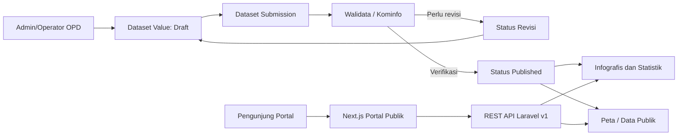
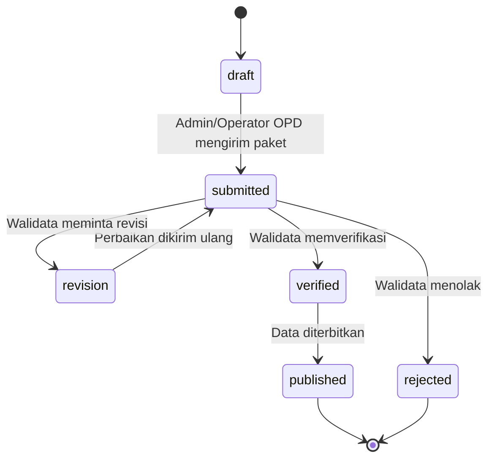
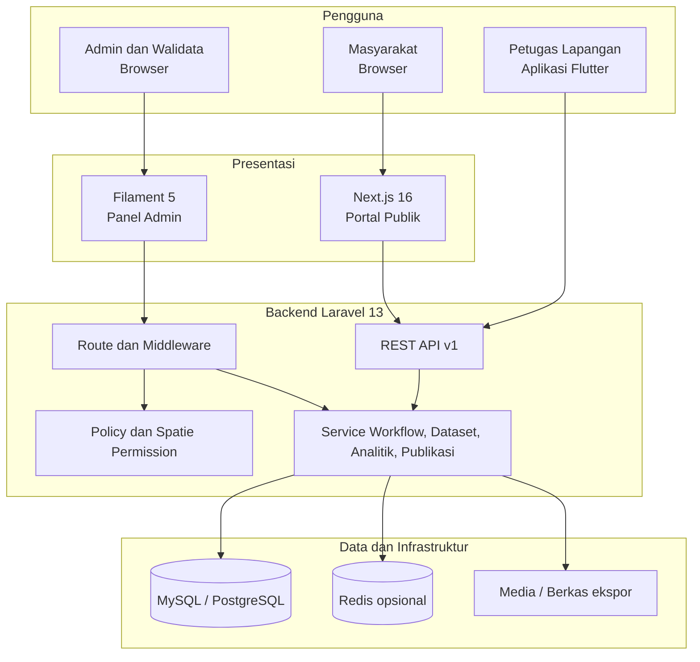
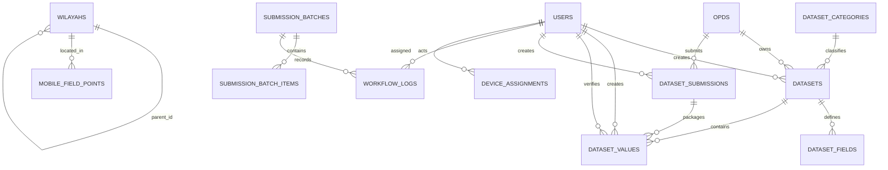

# ANALISIS DAN PERANCANGAN SISTEM WEB
## SIPANDU — Sistem Informasi Pangkalan Data Terpadu Kabupaten Kepulauan Sangihe

**Jenis dokumen:** Analisis dan Perancangan Sistem Web  
**Basis audit:** Source code proyek pada 2 November 2026  
**Ruang lingkup:** Panel administrasi, portal publik, API, dan backend web  
**Status:** Dokumen kondisi implementasi saat ini dan rancangan pengembangan

---

## Ringkasan Eksekutif

SIPANDU merupakan platform Satu Data Pemerintah Kabupaten Kepulauan Sangihe. Sistem ini menyatukan pengelolaan dataset sektoral dari Organisasi Perangkat Daerah (OPD), data wilayah, proses verifikasi Walidata, penyajian infografis, peta, portal informasi publik, serta dashboard pemantauan. Sistem tidak lagi dirancang sebagai aplikasi terpisah untuk setiap OPD. Setiap OPD mengelola dataset melalui struktur yang dapat dikonfigurasi, sedangkan Kominfo/Walidata mengendalikan kualitas dan publikasi data.

Audit source code menunjukkan bahwa aplikasi web saat ini terdiri dari tiga lapisan yang terhubung: Laravel sebagai backend dan API, Filament sebagai panel administrasi, serta Next.js sebagai portal publik. Katalog dataset sudah mendukung metadata Satu Data Indonesia (SDI), kolom dinamis, nilai data berbasis periode/wilayah, dan siklus verifikasi. Portal publik hanya mengonsumsi endpoint baca sehingga dipisahkan dari proses pengubahan data oleh administrator.

Dokumen ini membedakan antara **fitur yang telah terimplementasi** dan **rancangan/rekomendasi**. Hal ini penting agar laporan tidak menyatakan fitur sebagai selesai bila belum tersedia pada source code.

---

# BAB III — ANALISIS SISTEM

## 3.1 Metode dan Batas Audit

Audit dilakukan secara statis pada struktur proyek, konfigurasi dependensi, route, controller, model, migration, halaman Filament, halaman Next.js, dan pengujian yang tersedia. Audit ini tidak mencakup uji penetrasi, audit konfigurasi server produksi, ataupun pengukuran performa pada data produksi.

Artefak utama yang menjadi dasar analisis adalah:

| Area | Artefak yang diperiksa | Kesimpulan utama |
|---|---|---|
| Backend | `composer.json`, `routes/web.php`, `routes/api.php`, controller dan service Laravel | Backend memakai Laravel 13, API versi `v1`, Sanctum, Spatie Permission, ekspor PDF/Excel, dan workflow data. |
| Panel administrasi | `app/Filament/Pages`, `app/Filament/Resources`, policy, widget | Panel mengelola master data, katalog dataset, input nilai, verifikasi, dashboard, konten portal, dan monitoring. |
| Portal publik | `frontend/src/app`, `frontend/src/components`, `frontend/src/lib/api` | Portal memakai Next.js 16, React 19, TypeScript, dan Tailwind CSS; data diambil dari REST API Laravel. |
| Database | migration dan model Eloquent | Struktur inti saat ini berpusat pada `wilayahs`, `opds`, `datasets`, `dataset_fields`, `dataset_values`, `dataset_submissions`, dan `workflow_logs`. |
| Keamanan aplikasi | middleware, policy, route, model pengguna | Akses dibatasi role dan lingkup organisasi/wilayah; endpoint publik dipisahkan dari endpoint autentikasi. |

> Catatan perubahan versi: laporan lama `BAB_III_ANALISA_DAN_PERANCANGAN.md` masih menyebut tabel terpisah `kecamatans`, `desas`, `rumahs`, `keluargas`, dan `penduduks`. Implementasi kini menggunakan master wilayah terpadu (`wilayahs`) dan platform dataset generik. Oleh karena itu, dokumen ini menjadi rujukan yang lebih sesuai dengan kondisi source code saat audit.

## 3.2 Identifikasi Permasalahan

Sebelum sistem terintegrasi, pendataan pemerintahan umumnya menghadapi permasalahan berikut.

1. Data sektoral berada pada banyak berkas atau aplikasi OPD sehingga sulit dikonsolidasikan.
2. Definisi, periode, satuan, dan sumber data belum selalu tercatat bersama nilai datanya.
3. Data yang belum diperiksa dapat tercampur dengan data resmi ketika dipakai dalam laporan atau publikasi.
4. Pimpinan membutuhkan ringkasan pemantauan tanpa harus membuka data operasional satu per satu.
5. Masyarakat membutuhkan kanal resmi untuk informasi daerah, berita, statistik, peta, dan infografis.
6. Data wilayah perlu menjadi referensi bersama agar data dari OPD dapat dibandingkan pada lingkup kabupaten, kecamatan, desa/kampung, dan dusun.

## 3.3 Analisis Sistem Berjalan

### 3.3.1 Gambaran Proses Saat Ini

Sistem yang berjalan menerapkan dua jalur utama.

1. **Jalur data sektoral OPD:** Admin/Operator OPD membuat atau memperbarui nilai suatu dataset, menyimpan sebagai draft, mengirim paket data, lalu Walidata/Kominfo memverifikasi atau mengembalikannya untuk revisi. Nilai yang lolos verifikasi dapat diterbitkan dan dipakai oleh infografis atau kanal publik sesuai aturan publikasi.
2. **Jalur informasi publik:** Admin portal mengelola konten; portal Next.js mengambil data baca dari API publik. Pengunjung melihat informasi tanpa akun dan tidak dapat mengubah data.



### 3.3.2 Aktor dan Hak Akses

Sistem menggunakan role dari Spatie Permission dan enumerasi `AppRole`. Terdapat role umum serta role spesifik OPD. Ringkasan peran utama adalah sebagai berikut.

| Aktor | Tujuan utama | Hak akses utama |
|---|---|---|
| Super Admin / Administrator | Menjaga konfigurasi platform | Mengelola pengguna, role, wilayah, OPD, dataset, audit, dan konfigurasi. |
| Admin Kominfo / Walidata | Menjaga kualitas data kabupaten | Memantau data, memverifikasi kiriman OPD, menerbitkan data, dan memantau proses. |
| Admin/Operator OPD | Memproduksi data sektoral | Mengelola dataset dan nilai data pada OPD sendiri, lalu mengirimkannya untuk verifikasi. |
| Kepala Dinas | Memantau atau mengesahkan data OPD | Akses dashboard dan data sesuai wewenang OPD. |
| Admin Portal / Admin Berita | Mengelola informasi publik | Mengelola konten portal, berita, dan materi informasi daerah. |
| Bupati / Wakil Bupati | Mengambil keputusan | Mengakses dashboard eksekutif dan laporan sesuai pembatasan panel. |
| Admin Kecamatan | Memeriksa data lapangan | Meninjau kiriman pendataan lapangan di wilayah tugas dan meneruskan ke Kominfo. |
| Pengunjung publik | Mengakses informasi | Melihat portal, berita, statistik, peta, layanan, dan infografis tanpa autentikasi. |

### 3.3.3 Kebutuhan Fungsional

| Kode | Kebutuhan | Status pada implementasi |
|---|---|---|
| WF-01 | Autentikasi pengguna dan pembatasan hak akses berbasis role. | Tersedia melalui autentikasi Laravel, Sanctum, Filament, dan Spatie Permission. |
| WF-02 | Mengelola master wilayah bertingkat dan OPD. | Tersedia melalui model `Wilayah`, `Opd`, resource, serta data referensi. |
| WF-03 | Membuat katalog dataset yang dapat dikonfigurasi per OPD. | Tersedia melalui `datasets` dan `dataset_fields`. |
| WF-04 | Mengisi nilai data berdasarkan periode dan cakupan wilayah. | Tersedia melalui `dataset_values` dan halaman input dataset. |
| WF-05 | Merekam metadata SDI dan standar data. | Tersedia untuk metadata dataset dan elemen field seperti konsep, definisi, klasifikasi, ukuran, dan satuan. |
| WF-06 | Mengirim sekumpulan nilai data ke Walidata. | Tersedia melalui `dataset_submissions`. |
| WF-07 | Memverifikasi, menerbitkan, atau meminta revisi data. | Tersedia pada controller review dan status nilai data. |
| WF-08 | Menampilkan dashboard dan monitoring. | Tersedia melalui halaman/wiget Filament termasuk dashboard eksekutif dan OPD. |
| WF-09 | Mengekspor laporan PDF dan Excel. | Tersedia pada route laporan yang dilindungi autentikasi dan wewenang. |
| WF-10 | Menyajikan portal publik. | Tersedia melalui frontend Next.js dan endpoint `/api/v1/public/*`. |
| WF-11 | Menampilkan infografis, peta, statistik, berita, layanan, dan informasi daerah. | Tersedia pada halaman publik serta controller API terkait. |
| WF-12 | Menyediakan endpoint bagi aplikasi mobile. | Tersedia pada prefix `/api/v1/mobile`; rincian ada pada dokumen mobile. |

### 3.3.4 Kebutuhan Nonfungsional

| Aspek | Kebutuhan dan rancangan |
|---|---|
| Keamanan | HTTPS pada produksi, autentikasi, token Sanctum untuk API terlindungi, CSRF/session untuk panel web, policy dan pembatasan role/lingkup data. |
| Kinerja | Paginasi untuk data tabel, indeks basis data pada dataset/periode/wilayah, caching untuk konten publik, dan revalidasi portal publik per 60 detik. |
| Ketersediaan | Endpoint kesehatan `/up`, backup basis data, pemantauan error, dan prosedur pemulihan perlu diterapkan pada infrastruktur produksi. |
| Skalabilitas | Dataset dinamis menghindari pembuatan tabel baru untuk setiap OPD; queue dan Redis dapat digunakan untuk pekerjaan berat. |
| Kegunaan | Antarmuka Indonesia, navigasi per role, dashboard ringkas, formulir berdasarkan kolom dataset, serta portal responsif. |
| Integritas data | Validasi server, foreign key, status workflow, pencatatan pengirim/pemeriksa, dan pembatasan publikasi. |
| Keterlacakan | `created_by`, `verified_by`, waktu verifikasi/publikasi, submission, batch, dan `workflow_logs`. |
| Interoperabilitas | API JSON berversi `v1`; ekspor XLSX/PDF; metadata format dan lisensi pada dataset. |

## 3.4 Analisis Data dan Aturan Bisnis

### 3.4.1 Master Wilayah

Master wilayah memakai satu tabel `wilayahs` dengan pola relasi diri (`parent_id`). Tipe wilayah mencakup kabupaten, kecamatan, desa, kampung, dan dusun. Pendekatan ini mengurangi duplikasi struktur tabel dan memudahkan penambahan hierarki wilayah.

### 3.4.2 Dataset Dinamis

Dataset didefinisikan oleh OPD, kode, nama, frekuensi/periode, tipe geometri, metadata SDI, serta konfigurasi. Kolom data tidak diprogram khusus untuk setiap dataset, melainkan dicatat pada `dataset_fields`. Nilai aktual disimpan sebagai JSON pada `dataset_values` agar satu struktur platform dapat melayani banyak urusan pemerintahan.

Aturan bisnis utama:

1. Kode dataset unik dalam satu OPD.
2. Setiap field unik dalam satu dataset dan memiliki urutan tampilan.
3. Nilai data terkait dataset dan dapat diberi tahun, label periode, serta cakupan wilayah.
4. Nilai baru mengikuti status `draft`; data kiriman berstatus `submitted`; hasil verifikasi dapat menjadi `verified`, `published`, `revision`, atau `rejected`.
5. Portal publik hanya boleh memperoleh data yang telah diterbitkan atau secara eksplisit diizinkan untuk publikasi.

### 3.4.3 Workflow Sektoral



Untuk pendataan lapangan dari mobile terdapat batch terpisah. Batch tersebut wajib melewati pemeriksaan Admin Kecamatan sebelum dapat diteruskan ke Kominfo untuk persetujuan akhir. Rancangan detailnya dijelaskan pada dokumen mobile.

## 3.5 Hasil Audit dan Rekomendasi

### 3.5.1 Kekuatan Sistem

1. Arsitektur API-first memisahkan portal publik, panel admin, dan aplikasi mobile.
2. Dataset dinamis membuat platform dapat berkembang ke banyak OPD tanpa membuat modul tabel baru untuk setiap urusan.
3. Metadata SDI dan status publikasi telah menjadi bagian dari model data.
4. Workflow memisahkan data draft dari data yang dapat diterbitkan.
5. Pembatasan role serta cakupan OPD/wilayah sudah menjadi konsep inti pada aplikasi.
6. Portal publik memakai halaman terpisah untuk berita, statistik, peta, infografis, layanan, dan profil daerah.

### 3.5.2 Temuan yang Perlu Ditindaklanjuti

| Prioritas | Temuan | Dampak | Rekomendasi |
|---|---|---|---|
| Tinggi | Dokumentasi lama tidak sesuai dengan model data terkini. | Membingungkan pembaca laporan dan pengembang baru. | Gunakan dua dokumen ini sebagai referensi baru, lalu perbarui daftar isi laporan magang. |
| Tinggi | Basis data memiliki jejak migrasi legacy dan model yang diarsipkan. | Risiko perbedaan struktur pada instalasi baru bila proses migrasi tidak didokumentasikan. | Tetapkan prosedur instalasi/migrasi bersih, data dictionary, dan uji migrasi dari database kosong. |
| Sedang | Status proses data sektoral dan batch lapangan menggunakan istilah berbeda. | Dashboard dan pelaporan dapat salah menafsirkan status jika kontrak tidak ditegaskan. | Dokumentasikan state machine tiap jalur data dan buat konstanta/kontrak API yang konsisten. |
| Sedang | Data JSON dinamis mudah dikembangkan, tetapi pencarian/agregasi field tertentu berpotensi mahal. | Kinerja analitik dapat menurun pada volume besar. | Indeks kolom umum, materialized/summary table, atau ekstraksi field penting untuk laporan. |
| Sedang | Konfigurasi produksi tidak dapat dibuktikan dari source code. | HTTPS, backup, cache, queue, dan observabilitas mungkin belum seragam. | Buat checklist deployment, backup terjadwal, pemantauan, serta uji restore. |
| Rendah | Endpoint publik harus terus diseleksi berdasarkan status publikasi dan data sensitif. | Risiko pengungkapan data jika query baru tidak mengikuti filter standar. | Gunakan service/query scope publik terpusat dan tambah uji akses negatif. |

---

# BAB III — PERANCANGAN SISTEM WEB

## 3.6 Arsitektur Sistem



### 3.6.1 Teknologi

| Lapisan | Teknologi implementasi |
|---|---|
| Backend | PHP 8.5, Laravel 13, Eloquent ORM, Laravel Sanctum |
| Panel admin | Filament 5 dan Blade/Livewire |
| Portal publik | Next.js 16, React 19, TypeScript, Axios, Tailwind CSS 4 |
| Otorisasi | Spatie Laravel Permission, policy, middleware, lingkup OPD/wilayah |
| Basis data | Relasional; migration mendukung MySQL/PostgreSQL sesuai konfigurasi Laravel |
| Dokumen | DomPDF untuk PDF dan Laravel Excel untuk XLSX |
| Integrasi | REST JSON dengan prefix API `/api/v1` |

## 3.7 Perancangan Basis Data

### 3.7.1 Entity Relationship Diagram



### 3.7.2 Kamus Data Inti

| Entitas | Atribut penting | Fungsi |
|---|---|---|
| `wilayahs` | `parent_id`, `tipe`, `kode_bps`, `nama`, koordinat, `aktif` | Master wilayah berhierarki. |
| `opds` | kode, nama, aktif, atribut verifikator | Pemilik/penghasil data sektoral. |
| `datasets` | OPD, kode, nama, periode, geometri, metadata SDI, lisensi, status | Definisi sebuah dataset. |
| `dataset_fields` | nama, label, tipe, validasi, opsi, standar data, urutan | Definisi kolom dinamis dataset. |
| `dataset_values` | dataset, periode, wilayah, `values` JSON, status, pemeriksa, publikasi | Rekaman nilai data sektoral. |
| `dataset_submissions` | OPD, pembuat, status, catatan, waktu kirim | Paket nilai data yang diperiksa Walidata. |
| `submission_batches` | modul, wilayah, status, ringkasan, snapshot, pembuat | Paket workflow terutama untuk pendataan lapangan/modul lain. |
| `workflow_logs` | batch, status asal/tujuan, aktor, catatan | Riwayat perubahan workflow batch. |
| `portal_contents` / berita terkait | judul, isi, media, status | Materi yang ditampilkan pada portal publik. |

## 3.8 Perancangan Use Case

| Use case | Aktor | Prasyarat | Alur ringkas | Keluaran |
|---|---|---|---|---|
| Kelola dataset | Admin OPD / Super Admin | Sudah login dan memiliki OPD | Buat/pilih dataset, isi metadata, atur field. | Definisi dataset aktif. |
| Input nilai data | Admin/Operator OPD | Dataset dan field tersedia | Pilih dataset, periode, wilayah, isi nilai, simpan. | Nilai berstatus draft. |
| Kirim data sektoral | Admin/Operator OPD | Memiliki nilai draft/revisi | Pilih nilai, beri catatan, kirim. | Paket `submitted`. |
| Verifikasi data | Walidata/Kominfo | Paket berstatus submitted | Periksa nilai, pilih terbitkan atau revisi. | Nilai published atau revision. |
| Kelola konten publik | Admin Portal/Berita | Sudah login | Membuat/memperbarui konten atau berita. | Konten siap dikonsumsi portal. |
| Lihat informasi publik | Pengunjung | Akses internet | Membuka halaman portal. | Informasi, peta, statistik, atau infografis. |
| Ekspor laporan | Pengguna berwenang | Sesi web dan izin ekspor | Memilih jenis laporan dan format. | Berkas PDF/XLSX. |

## 3.9 Perancangan Antarmuka

### 3.9.1 Panel Administrasi

Navigasi panel disusun berdasarkan role. Desain utama yang disarankan:

```text
+---------------------------------------------------------------+
| Logo SIPANDU | Pencarian | Notifikasi | Profil pengguna       |
+--------------------+------------------------------------------+
| Dashboard          | Ringkasan peran dan indikator utama        |
| Data Sektoral      | [Kartu Dataset] [Draft] [Terkirim]         |
| - Katalog Dataset  | [Grafik tren] [Tabel data terbaru]          |
| - Input Data       |                                          |
| - Kirim Data       |                                          |
| - Verifikasi       |                                          |
| Wilayah/OPD        |                                          |
| Portal Publik      |                                          |
| Laporan            |                                          |
+--------------------+------------------------------------------+
```

Prinsip antarmuka:

1. Tampilkan menu hanya bila pengguna memiliki otorisasi.
2. Berikan indikator status yang konsisten: Draft, Dikirim, Perlu Revisi, Ditolak, Terverifikasi, Diterbitkan.
3. Gunakan filter OPD, dataset, periode, dan wilayah pada tabel serta dashboard.
4. Tampilkan catatan Walidata pada data yang perlu revisi.
5. Konfirmasi sebelum aksi irreversibel seperti publikasi atau pengarsipan.

### 3.9.2 Portal Publik

Halaman publik yang telah dirancang/ditemukan di frontend meliputi Beranda, Berita, Statistik, Peta Sebaran, Infografis, Layanan, Sambutan, Pejabat, OPD, Sejarah, Visi-Misi, Geografi, dan Lambang daerah.

```text
+----------------------------------------------------------------+
| Header: Logo | Beranda | Tentang | Berita | Statistik | Peta    |
+----------------------------------------------------------------+
| Hero: informasi resmi daerah, gambar/video, tautan utama        |
+----------------------------------------------------------------+
| Ringkasan statistik | kartu informasi | berita terbaru           |
+----------------------------------------------------------------+
| Footer: kontak, tautan layanan, informasi pemerintah             |
+----------------------------------------------------------------+
```

Portal harus menampilkan keadaan kosong yang informatif ketika API belum menyediakan data; pola ini sudah digunakan pada halaman peta dan statistik.

## 3.10 Perancangan API

### 3.10.1 Prinsip API

1. Prefix versi API adalah `/api/v1` agar perubahan besar dapat dikendalikan.
2. Endpoint publik bersifat baca-saja dan tidak memerlukan token.
3. Endpoint administrasi/mobil memakai autentikasi dan pembatasan role.
4. Semua data dikirim dalam JSON, kecuali endpoint berkas ekspor.
5. Kesalahan validasi harus menggunakan kode HTTP dan pesan yang dapat ditampilkan pengguna.

### 3.10.2 Endpoint Web yang Tersedia

| Metode | Endpoint | Autentikasi | Kegunaan |
|---|---|---|---|
| GET | `/up` | Tidak | Pemeriksaan kesehatan layanan Laravel. |
| GET | `/api/v1/public/home` | Tidak | Beranda portal, hero, statistik, dan berita. |
| GET | `/api/v1/public/berita` | Tidak | Daftar berita publik. |
| GET | `/api/v1/public/berita/{slug}` | Tidak | Detail berita. |
| GET | `/api/v1/public/statistik` | Tidak | Statistik publik. |
| GET | `/api/v1/public/peta` | Tidak | Data peta dan indikator publik. |
| GET | `/api/v1/public/peta/cari` | Tidak, throttle | Pencarian data peta publik. |
| GET | `/api/v1/public/infografis` | Tidak | Daftar infografis dari data terbit. |
| GET | `/api/v1/public/infografis/{slug}` | Tidak | Detail infografis. |
| GET | `/api/v1/public/tentang-daerah/*` | Tidak | Informasi profil Kabupaten Kepulauan Sangihe. |
| GET/POST | `/api/v1/registration/*` | Tidak | Data formulir dan pengiriman registrasi. |
| GET | `/laporan/*/pdf` atau `/excel` | Sesi web dan wewenang | Ekspor laporan administrasi. |

Endpoint internal untuk input dan verifikasi panel berjalan melalui route Laravel/Filament yang menggunakan session web, policy, dan controller terkait. Endpoint mobile dipisahkan pada `/api/v1/mobile/*`.

## 3.11 Rancangan Pengujian

| ID Uji | Skenario | Hasil yang diharapkan |
|---|---|---|
| TW-01 | Pengguna OPD membuka katalog dataset. | Hanya dataset OPD pengguna yang tampil, kecuali role kabupaten. |
| TW-02 | Operator menyimpan data dengan field wajib kosong. | Sistem menolak dan menampilkan pesan validasi. |
| TW-03 | Operator mengirim data draft. | Dibuat `dataset_submission`; nilai berubah menjadi submitted. |
| TW-04 | Walidata meminta revisi. | Nilai/paket berstatus revision dan catatan dapat dilihat OPD. |
| TW-05 | Walidata menerbitkan paket valid. | Nilai berstatus published serta timestamp publikasi terisi. |
| TW-06 | Pengunjung membuka infografis. | Hanya data yang telah terbit dan diizinkan tampil. |
| TW-07 | Pengguna tanpa izin memanggil ekspor. | Server mengembalikan penolakan akses. |
| TW-08 | Endpoint `/up` diakses monitor. | Respons JSON menunjukkan status layanan. |
| TW-09 | Portal gagal memperoleh data peta/statistik. | UI menampilkan keadaan kosong, bukan halaman rusak. |

## 3.12 Rencana Implementasi dan Operasi

1. Siapkan environment PHP, Composer, Node.js, basis data, dan variabel `.env` tanpa menyimpan rahasia pada repository.
2. Jalankan migration serta seeder yang diperlukan, lalu buat akun role dasar dan data master wilayah/OPD.
3. Konfigurasikan domain, HTTPS, CORS untuk domain Next.js, storage media, mail/notification, queue, dan cache.
4. Jalankan pengujian unit/feature untuk workflow, pembatasan akses, input dataset, endpoint publik, dan ekspor.
5. Lakukan backup harian basis data serta uji pemulihan secara berkala.
6. Catat perubahan struktur dengan migration baru; jangan mengubah migration historis yang telah digunakan instalasi lain.

## 3.13 Kesimpulan Web

SIPANDU Web telah memiliki fondasi yang sesuai untuk platform data pemerintahan: dataset dinamis per OPD, metadata SDI, workflow verifikasi, panel administrasi berbasis role, layanan ekspor, dan portal publik terpisah. Prioritas lanjutan adalah merapikan dokumentasi serta migrasi legacy, memperjelas kontrak status antarjalur data, memastikan filter publikasi konsisten, dan mematangkan operasi produksi (backup, monitoring, cache, serta pengujian akses).
