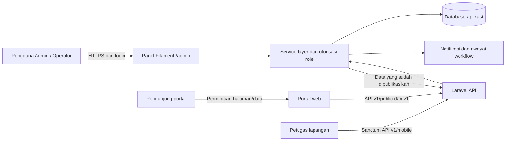
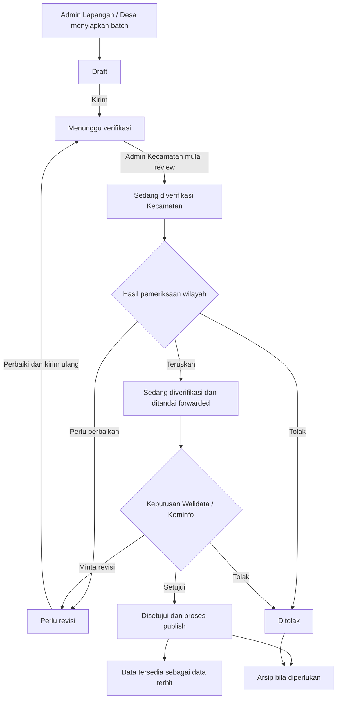
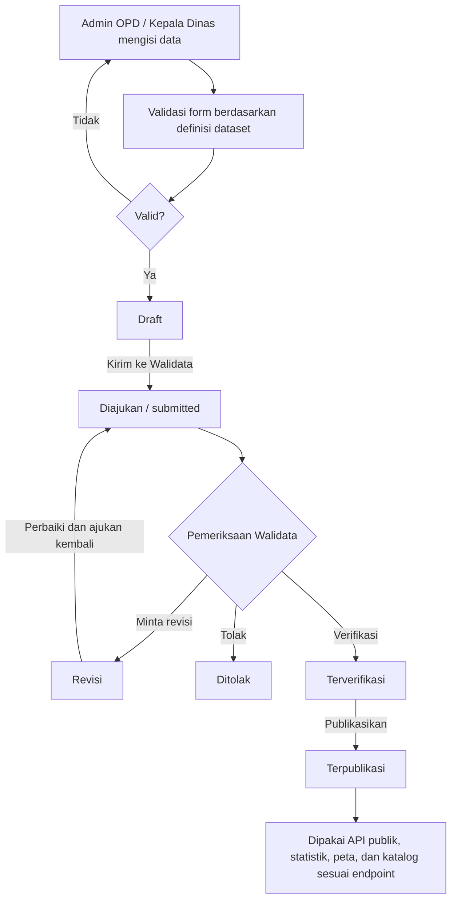
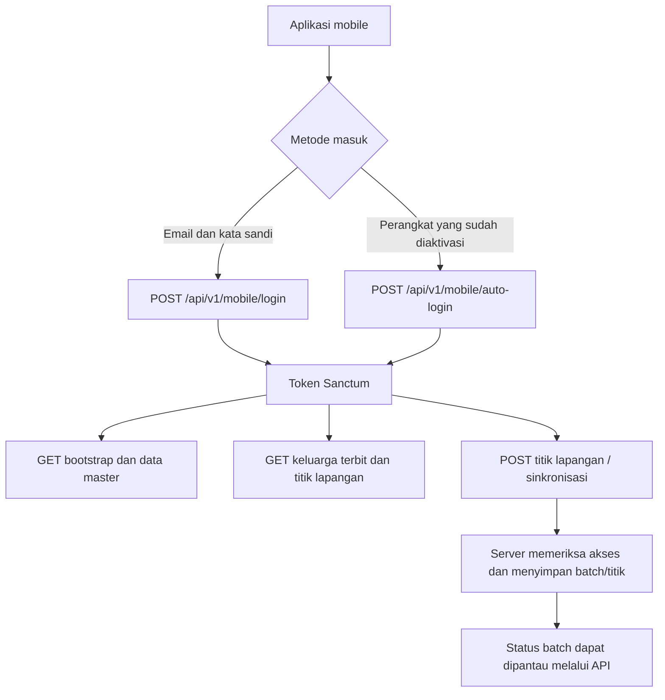

# Audit dan Flowchart Sistem SIPANDU

Dokumen ini merangkum alur yang teridentifikasi pada implementasi repository per 8 November 2026. Diagram ditulis dalam Mermaid agar dapat dirender oleh editor Markdown yang mendukung Mermaid. Pemeriksaan runtime dilakukan dengan PHP 8.5.12 dari `.runtime/php85` memakai konfigurasi `scripts/php.ini`.

## 1. Ruang lingkup audit

- Panel admin menggunakan Laravel dan Filament pada rute `/admin`; autentikasi panel mengikuti middleware Filament dan pembatasan akses per role.
- API publik v1 melayani statistik, peta, berita, infografis, halaman portal, dan informasi daerah. API mobile v1 menangani autentikasi, bootstrap, data master keluarga terbit, dan titik lapangan.
- Alur batch memakai `BatchApprovalService` dan `WorkflowEngine`; alur dataset sektoral dinamis memakai `DatasetValueManager`. Keduanya memiliki state dan aturan publikasi yang berbeda.
- Dokumentasi arsitektur di root memuat sejumlah rancangan target dan nama teknologi/status lama. Diagram berikut mengutamakan alur yang ditemukan pada kode aplikasi.

## 2. Flowchart konteks sistem

## 3. Flowchart batch lapangan

Catatan: batch lapangan yang memerlukan pemeriksaan Kecamatan wajib diteruskan sebelum keputusan akhir Walidata. Admin Kecamatan tidak dapat memberikan persetujuan akhir. Kode juga mendukung batch tanpa gerbang Kecamatan yang dapat mulai direview Walidata secara langsung.

## 4. Flowchart dataset sektoral dinamis

Record dataset dibatasi ke OPD pemilik saat dibuat/dikirim; publikasi hanya dapat dilakukan oleh Walidata atau super admin. Sebagian endpoint publik secara eksplisit menyaring status `published` dan waktu publikasi.

## 5. Flowchart akses mobile lapangan

## 6. Ringkasan temuan audit

1. Identitas visual admin sebelumnya hanya menggunakan nama brand `SIPANDU`; konfigurasi panel kini menggunakan `logo.png` dari direktori publik.
2. Terdapat dua mekanisme verifikasi: workflow batch multi-tahap dan workflow nilai dataset sektoral. Status dan langkahnya tidak boleh disatukan dalam satu diagram status.
3. Peran dan akses ditegakkan oleh middleware, policy, service, serta pemeriksaan role di alur workflow; hak final publish bersifat terbatas.
4. API mobile memerlukan Sanctum untuk endpoint operasional; endpoint login dan auto-login diberi rate limit API. Endpoint publik dibuka tanpa autentikasi.
5. Dokumentasi `ARCHITECTURE.md` adalah campuran rancangan target dan status historis (misalnya stack versi lama). Status fitur harus diverifikasi terhadap service/controller aktif sebelum dipakai sebagai klaim implementasi.

## 7. Rujukan kode utama

- `app/Providers/Filament/AdminPanelProvider.php` — konfigurasi panel admin dan logo.
- `app/Services/Workflow/WorkflowEngine.php` dan `app/Services/BatchApprovalService.php` — transisi, otorisasi, dan publish batch.
- `app/Services/DataInput/DatasetValueManager.php` — draft sampai publikasi nilai sektoral.
- `app/Http/Controllers/Api/MobileAuthController.php`, `MobileBootstrapController.php`, dan `MobileFieldController.php` — API mobile.
- `routes/api.php` dan `routes/web.php` — rute API dan web.
- `app/Services/PublicDatasetCatalogService.php` serta controller `Public*` — pembacaan data publik.
